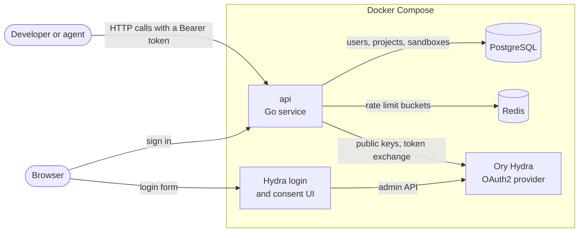
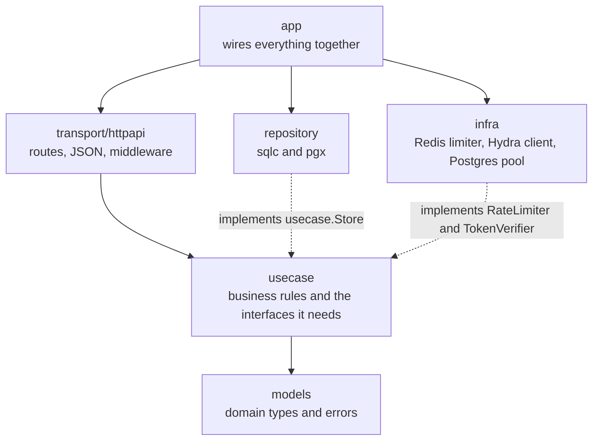
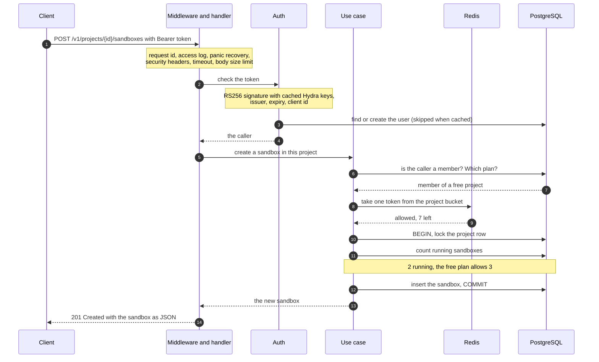
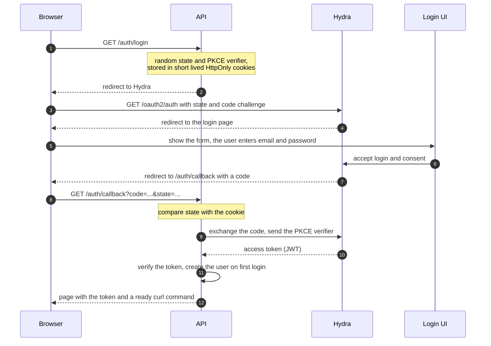
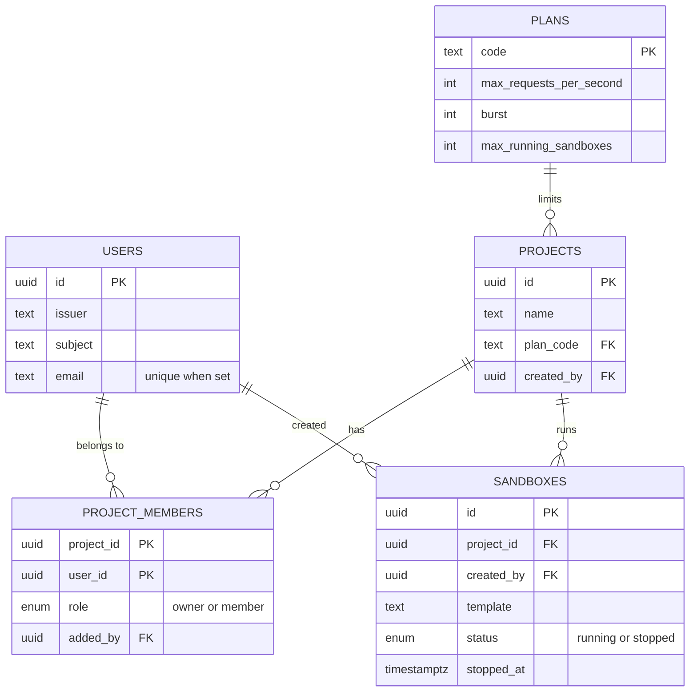

# Architecture

This page explains how the service is put together, how a request travels through it, and why the main pieces look the way they do.
The diagrams use Mermaid, which GitHub draws for you.

## The big picture

Five containers run in Docker Compose. Only our `api` is ours. The rest are given by the assignment or are plain infrastructure.

* **PostgreSQL** keeps everything that must not be lost: users, projects, memberships, sandboxes and the plans.
* **Redis** keeps only rate limit counters. Losing it never loses data.
* **Hydra** signs the tokens. The service never sees a password.

## Layers

The rule is simple: business code does not import infrastructure.

* `usecase` declares the interfaces it needs (`Store`, `RateLimiter`, `TokenVerifier`) and depends only on `models`.
* `repository` and `infra` implement them. The `app` package picks the implementations and connects them.
* `transport/httpapi` translates between HTTP and use cases. It holds no business rules.
* In tests the use cases run against a small in-memory store, so no database is needed to test the rules.

## What happens to a request

This is `POST /v1/projects/{id}/sandboxes`, the most interesting call because it touches every part of the system.

Step by step:

1. **Middleware.** Every request gets an id (taken from `X-Request-Id` if it is safe, otherwise generated). The access log, panic recovery and security headers wrap the call.
   A deadline of 10 seconds and a 1 MiB body limit protect the service from slow or huge requests.
2. **Authentication.** The bearer token is checked in `usecase.Auth`. The signature is verified with Hydra's public keys, which are cached in memory.
   Then the issuer, the expiry and the OAuth client are checked. The first valid token of a new person creates their account.
3. **Authorization.** One indexed query answers two questions: is the caller a member, and which plan does the project have?
   A caller who is not a member gets `404`, exactly like for a project that does not exist. They are also charged against a small "miss" bucket,
   so nobody can probe random ids for free.
4. **Rate limit.** One Lua script in Redis takes a token from the project's bucket. The bucket size and refill speed come from the plan.
   When the bucket is empty the answer is `429` with a `Retry-After` header.
5. **Quota.** A transaction locks the project row, counts the running sandboxes and compares the number with the plan.
   Because the lock is held until commit, two parallel requests cannot both take the last slot.
6. **Answer.** The sandbox is returned as JSON. If anything fails, the error handler turns it into a stable error code and never exposes internal text.

## Signing in

The service is an OAuth client. It uses the authorization code flow with PKCE.

After this the caller sends `Authorization: Bearer <token>` with every request. There are no server side sessions.

Two details come from looking at what Hydra really issues:

* The access token has `sub` set to the email, and there is no `email` claim anywhere. So users are identified by `(issuer, sub)`,
  and an email-shaped `sub` is used as the email for invitations.
* The token has an empty `aud`. The service therefore checks the `client_id` claim instead, which also rejects ID tokens and tokens of other OAuth clients.

## Data model

Why the tables look like this:

| Table | Reason |
|---|---|
| `users` | One row per identity at the OAuth provider. `(issuer, subject)` is unique. Email is only an attribute, because it can change or be missing |
| `plans` | A plan is data, not code. Changing a limit is one `UPDATE`, and every project on that plan follows |
| `projects` | The unit of tenancy. Everything a customer owns hangs off a project |
| `project_members` | The many-to-many link between users and projects. Its primary key answers "who is in this project", and an extra index answers "which projects does this user see" |
| `sandboxes` | The managed records. `project_id` is the natural key to shard by. A check constraint keeps `status` and `stopped_at` in agreement |

More choices:

* **UUIDv7 ids.** They sort by creation time, so inserts stay at the end of the index, and they cannot be guessed.
* **No deletes.** A sandbox is stopped, never removed. The row stays for history and billing.
* **A partial index on running sandboxes.** The quota query counts only running rows, so it stays fast however many stopped ones pile up.
* **Names.** Tables are plural nouns. Constraints and indexes say what they protect, for example `users_identity_key`.
* **`sandboxes.template` is plain text.** A real product has a template catalog with a foreign key. This simulation has no catalog.

## The patterns that matter

### Shared work with singleflight

Hydra keeps its signing keys in memory. After a restart it has new keys, and the next requests all arrive with a key id the service has never seen.
Without care, every request would call Hydra at once.

`JWKS` collapses them into one fetch with `singleflight`. All waiting requests share the answer, and a request that gets cancelled stops waiting without stopping the fetch for the others.
Unknown key ids can only trigger a refetch once every 5 seconds, so random ids cannot be used to hammer Hydra.
The same idea, packaged as `pkg/ttlcache`, keeps plans and known users in memory.

### Rate limiting with a token bucket in Redis

Each project has a bucket. A request takes one token and tokens come back at the plan's speed.

On the free plan the bucket holds 10 tokens and gets 5 back every second. A burst of 10 requests passes at once.
After that about 5 requests per second pass, and the rest get `429` with a `Retry-After` header.

The whole decision (read the bucket, add the tokens that came back, take one, write the result) is one Lua script.
Redis runs it as a single step, so many API instances can share the same bucket without races.
It uses the Redis clock, so servers with different clocks still agree.

Details that are easy to get wrong:

* Keys look like `rl:{project:<id>}`. The braces make Redis Cluster put all buckets of one tenant on the same node.
* The client never retries the script. A retry after a lost reply could take two tokens for one request.
* A circuit breaker watches Redis. After five failures in a row it stops calling Redis for ten seconds.
  During that time requests go through without a limit, and the quotas in Postgres still apply.

### Quota with a row lock

Counting and inserting are two steps, so two requests could both see "2 running" and both insert. To prevent it, the transaction first runs
`SELECT ... FOR NO KEY UPDATE` on the project row. The second request waits for the first to finish, then sees "3 running" and is refused.
Other projects are not affected, and neither are other inserts that only reference the project, such as adding a member.
If the lock cannot be taken within 3 seconds the answer is `503` with `Retry-After`.

A test starts 30 parallel requests against a limit of 3 and expects exactly 3 successes.

### Keyset pagination

Lists return `next_cursor`, the id of the last item. The next page asks for ids greater than that cursor.
Unlike `OFFSET`, this stays fast on huge tables and never skips or repeats a row when data changes between pages.

### Timeouts and retries

| Where | Setting | Why |
|---|---|---|
| HTTP server | header 5s, read 15s, write 30s, idle 60s | Slow clients cannot hold connections forever |
| Each request | deadline 10s, body 1 MiB | One request cannot run or grow without a limit |
| Postgres | statement timeout 5s, lock timeout 3s | A slow query or lock cannot pin a connection |
| Redis | dial 1s, read and write 200ms | The limiter sits on every request and must stay fast |
| Hydra calls | timeout 5s, up to 3 attempts with growing delay and jitter | Fetching public keys is safe to repeat |
| Database transactions | up to 3 attempts after a deadlock | The whole transaction is simply run again |
| OAuth code exchange | no retry | A code works once, a repeat would always fail |

All numbers are named constants. The process-wide ones live in `internal/app/constants.go`.

## When something breaks

| What fails | What the user sees | What the service does |
|---|---|---|
| Redis is down | Requests work, limits are not applied for a while | The limiter fails open, the circuit breaker avoids slow timeouts, `/readyz` reports Redis as unavailable |
| Hydra is down | New logins fail. Calls with already known keys keep working | Cached keys are used. Unknown keys give `503`, not a misleading `401` |
| Hydra restarts | Old tokens work until the key cache expires, new tokens work at once | Unknown key ids trigger one shared refetch |
| PostgreSQL is down | `500` or `503` | `/readyz` fails, startup retries for a few seconds |
| A project row is locked for long | `503 busy` with `Retry-After` | The request gives up after 3 seconds and does not retry in a loop |
| Shutdown (SIGTERM) | In-flight requests finish | `/readyz` turns to `draining`, the server waits up to 20 seconds, then closes the rest |

## Security

* Tokens: algorithm fixed to RS256, issuer, expiry, subject and OAuth client are checked. `alg: none` and HMAC tricks are rejected.
* Access: every project route checks membership. Strangers get `404`, never `403`, so ids reveal nothing. Only owners can invite people.
* Input: bodies are size limited, JSON with unknown fields is rejected, project names refuse control and direction-override characters.
* OAuth: `state` and PKCE are used. Their cookies are `HttpOnly` and `SameSite=Lax`.
* Output: errors never contain internal text. Request ids from clients are validated before they reach logs.
* Deployment: the image is distroless and runs as a non-root user. No secret has a default value. Every port is bound to `127.0.0.1`.
* Checks: `golangci-lint` runs with the security linter (gosec).

## Decisions worth knowing

* **sqlc, not a query builder.** The assignment asks for sqlc generated code for all database access, so there is no squirrel.
* **Plans belong to projects.** A new project starts on `free`. Moving a project to another plan is a one-line update.
* **Owners invite.** The brief only says another user can be added, and the stricter reading keeps members from pulling strangers into a project.
* **429 for the sandbox quota.** It is the same status as the rate limit, but without `Retry-After`, because waiting does not help. Clients should read `error.code`.
* **Limits per project.** To stop users from multiplying them with many projects, one user can own at most 10.
